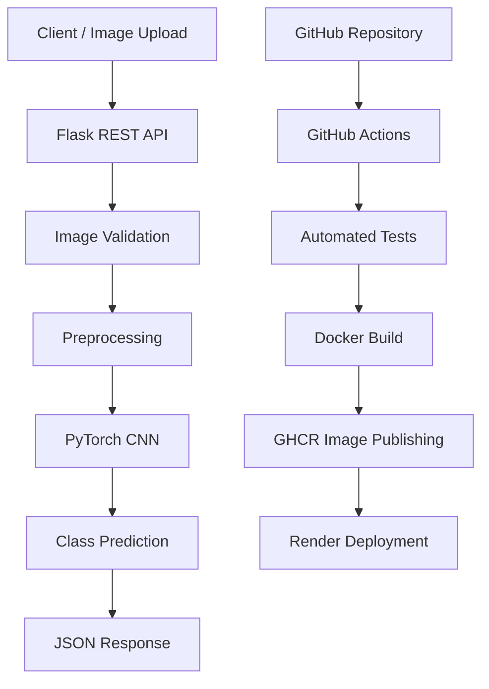

# Humanli Animal Classifier
### PyTorch CNN · Flask REST API · Docker · GitHub Actions · GHCR · Render

A production-oriented deep learning application that classifies animal-face images into **Cat, Dog, and Wild** categories using a custom Convolutional Neural Network (CNN) built with PyTorch.

The project was developed for the Humanli.ai Machine Learning / GenAI Engineer technical assignment: **CNN-Based Image Classification using PyTorch**.

It covers the complete workflow from image preprocessing and model evaluation to API development, containerization, automated testing, container registry publishing, and cloud deployment.

---

## Project at a glance

| Component | Details |
|---|---|
| Problem | Three-class animal image classification |
| Dataset | Animal Faces-HQ (AFHQ) |
| Model | Custom CNN |
| Deep learning framework | PyTorch |
| API framework | Flask |
| Input | RGB image, resized to 224 × 224 |
| Output classes | Cat, Dog, Wild |
| Model parameters | 1,206,499 |
| Held-out test accuracy | **97%** |
| Held-out macro F1-score | **97%** |
| Deployment | Render |
| Container registry | GitHub Container Registry (GHCR) |
| CI/CD | GitHub Actions |
| Automated API tests | 5 passing tests |

## Live Project & Evaluation Links

| Resource | Link |
|---|---|
| **Live API** | [Open deployed application](https://humanli-animal-classifier-latest.onrender.com/) |
| **GitHub Repository** | [View source code](https://github.com/GouravGC/humanli-animal-classifier) |
| **GitHub Actions** | [View CI/CD workflow](https://github.com/GouravGC/humanli-animal-classifier/actions/workflows/ci.yml) |
| **Docker Image (GHCR)** | [View published container package](https://github.com/GouravGC/humanli-animal-classifier/pkgs/container/humanli-animal-classifier) |
| **Demo & Evidence** | [View screenshots and recordings](https://github.com/GouravGC/humanli-animal-classifier/tree/main/evidence) |

---

## 1. Problem Statement

Manual image classification becomes difficult to scale when image collections contain variations in animal breeds, appearance, orientation, and visual characteristics.

This project implements a CNN-based image classification system that automatically identifies whether an uploaded animal-face image belongs to one of three categories:

- Cat
- Dog
- Wild animals

The objective is to develop and evaluate a deep learning model that learns meaningful visual features and generates predictions on previously unseen images.

## 2. Dataset

**Animal Faces-HQ (AFHQ)**

Source: [Official AFHQ dataset and documentation](https://github.com/clovaai/stargan-v2)

The dataset contains animal-face images across three domains: cats, dogs, and wildlife.

Dataset details used in this project:

- Total images: 16,130
- Original training partition: 14,630 images
- Held-out final test partition: 1,500 images
- Training partition split into:
  - Training: 11,704 images
  - Validation: 2,926 images

The class mapping is:

| Class | Label |
|---|---:|
| Cat | 0 |
| Dog | 1 |
| Wild | 2 |

Dataset manifests are included under `data_manifests/` within the retained project artifacts. Raw dataset images are not bundled in the repository.

## 3. Model Architecture

A custom CNN was implemented using PyTorch.

**Architecture overview:**

- Four convolutional feature-extraction blocks.
- Channel progression: 3 → 32 → 64 → 128 → 256.
- Two convolutional layers per block.
- Batch Normalization and ReLU activations.
- Max Pooling for spatial downsampling.
- Adaptive Average Pooling.
- Fully connected classification layers.
- Dropout for regularization.
- Three output classes.

**Model configuration:**

| Parameter | Configuration |
|---|---|
| Input channels | 3 (RGB) |
| Input resolution | 224 × 224 |
| Convolutional blocks | 4 |
| Optimizer | AdamW |
| Initial learning rate | 0.001 |
| Weight decay | 0.0001 |
| Loss function | Cross Entropy |
| Scheduler | ReduceLROnPlateau |
| Early stopping patience | 5 epochs |
| Training epochs | 12 |
| Total parameters | 1,206,499 |

### Image preprocessing

Input images undergo:

1. RGB conversion.
2. Resizing to 224 × 224.
3. Tensor conversion.
4. ImageNet mean and standard deviation normalization.

Training augmentation includes random horizontal flipping, rotation, and color jitter.

## 4. Model Evaluation

The final model was evaluated on a held-out test partition.

| Metric | Result |
|---|---:|
| Test Accuracy | **97.00%** |
| Macro Precision | **97.10%** |
| Macro Recall | **97.00%** |
| Macro F1-score | **97.00%** |

The project also retains training history, validation metrics, test metrics, and confusion matrix artifacts.

These results represent evaluation on the held-out dataset, not a guarantee of equivalent accuracy on arbitrary real-world images.

## 5. Application Architecture

The trained model is integrated into a Flask REST API.



### API endpoints

| Method | Endpoint | Purpose |
|---|---|---|
| GET | `/` | API information |
| GET | `/health` | Application health check |
| GET | `/model-info` | Model metadata |
| POST | `/predict` | Classify an uploaded image |

### Prediction request

The `/predict` endpoint accepts an image through multipart form data.

Example using cURL:

```bash
curl -X POST \
  -F "file=@test_image.jpg" \
  https://humanli-animal-classifier-latest.onrender.com/predict
```

The API validates uploaded files, processes valid images, performs inference, and returns a JSON prediction response.

Additional validation covers missing files, invalid images, and oversized uploads.

### Inference design

- Model is loaded once when the application starts.
- Inference runs on CPU in the deployed service.
- Images are preprocessed consistently with the model's training configuration.
- The API separates preprocessing, model architecture, inference, and request handling into modular components.

## 6. Production & Deployment

The application is containerized using Docker.

**Deployment components:**

- Flask application for model serving.
- Gunicorn as the production WSGI server.
- Docker image for portable deployment.
- GitHub Container Registry for image storage.
- Render for hosting the deployed API.

### Container image

Published image:

```text
ghcr.io/gouravgc/humanli-animal-classifier:latest
```

Version-specific images are also published using commit SHA tags.

[View GHCR package](https://github.com/GouravGC/humanli-animal-classifier/pkgs/container/humanli-animal-classifier)

## 7. CI/CD Pipeline

GitHub Actions automates the main integration and deployment workflow.

On pushes to the `main` branch:

1. Check out the repository.
2. Set up Python 3.11.
3. Install project dependencies.
4. Execute automated tests.
5. Build the Docker image.
6. Publish the image to GHCR with `latest` and commit-specific tags.
7. Trigger Render deployment using a GitHub Actions repository secret.

Pull requests run the tests and build validation without publishing an image or triggering deployment.

The Render deploy-hook URL is stored as a GitHub Actions secret and is not committed to the repository.

[View workflow runs and build results](https://github.com/GouravGC/humanli-animal-classifier/actions/workflows/ci.yml)

## 8. Automated Testing

The project includes API tests using pytest.

The test suite covers:

- Health endpoint.
- Model metadata endpoint.
- Successful image prediction.
- Missing image upload.
- Invalid image upload.

Run the tests locally:

```bash
python -m pytest tests -v
```

**Latest local verification: 5 tests passed.**

## 9. Project Structure

```text
humanli-animal-classifier/
│
├── app/
│   ├── __init__.py
│   ├── api.py
│   ├── inference.py
│   └── preprocessing.py
│
├── model/
│   ├── __init__.py
│   └── custom_cnn.py
│
├── artifacts/
│   ├── class_mapping.json
│   ├── model_config.json
│   ├── preprocessing_config.json
│   ├── custom_cnn_state_dict.pth
│   ├── custom_cnn.onnx
│   └── custom_cnn.onnx.data
│
├── tests/
│   └── test_api.py
│
├── evidence/
│   └── Demo videos and screenshots
│
├── .github/
│   └── workflows/
│       └── ci.yml
│
├── Dockerfile
├── .dockerignore
├── .gitignore
├── requirements.txt
└── README.md
```

## 10. Run Locally

### Prerequisites

- Python 3.11
- pip

### Install dependencies

```bash
git clone https://github.com/GouravGC/humanli-animal-classifier.git

cd humanli-animal-classifier

pip install -r requirements.txt
```

### Start the Flask API

```bash
python -m app.api
```

The local API is available at:

```text
http://localhost:5000
```

### Run automated tests

```bash
python -m pytest tests -v
```

## 11. Run with Docker

Build the image:

```bash
docker build -t humanli-animal-classifier .
```

Run the container:

```bash
docker run -p 5000:5000 humanli-animal-classifier
```

Access the API at:

```text
http://localhost:5000
```

## 12. Evidence & Demonstration

The repository's `evidence/` directory contains project demonstration material, including screenshots and video recordings.

These materials demonstrate the deployed application, API responses, model predictions, repository, container package, and CI/CD workflow.

[Open project evidence](https://github.com/GouravGC/humanli-animal-classifier/tree/main/evidence)

---

## 13. Key Engineering Contributions

This project demonstrates practical implementation across multiple stages of an ML deployment lifecycle:

- Custom CNN architecture development using PyTorch.
- Image preprocessing and augmentation.
- Training, validation, and held-out model evaluation.
- Modular inference pipeline and Flask API integration.
- Input validation and automated API testing.
- Docker-based application packaging.
- GitHub Actions automation.
- GHCR image publishing with version-specific tags.
- Render deployment through an automated deploy hook.

## Conclusion

Humanli Animal Classifier demonstrates an end-to-end deep learning workflow, from image classification model development to API integration and cloud deployment.

The implementation combines core machine learning and deep learning concepts with practical Python engineering, testing, containerization, and CI/CD practices.

**Repository:** https://github.com/GouravGC/humanli-animal-classifier

**Live API:** https://humanli-animal-classifier-latest.onrender.com/